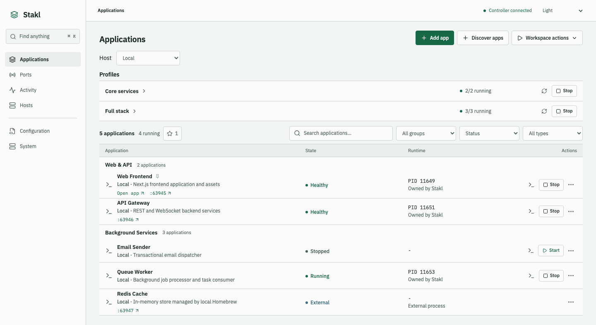
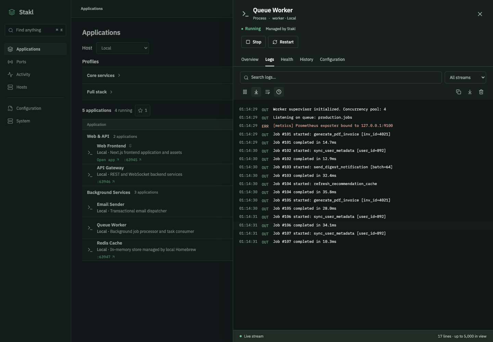
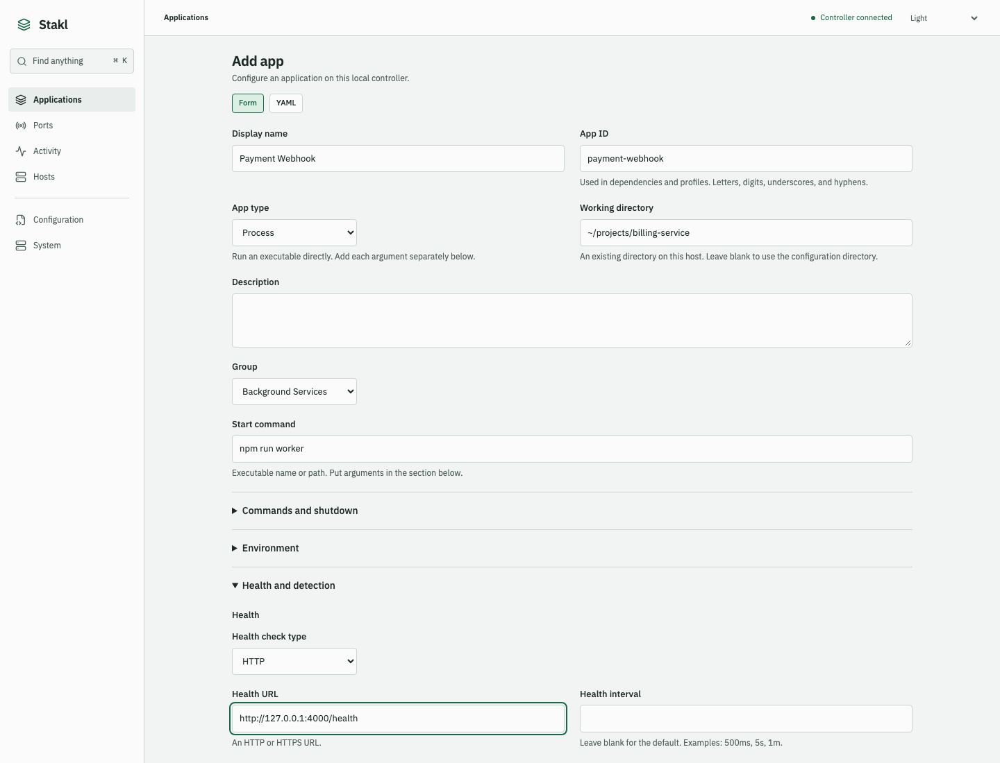
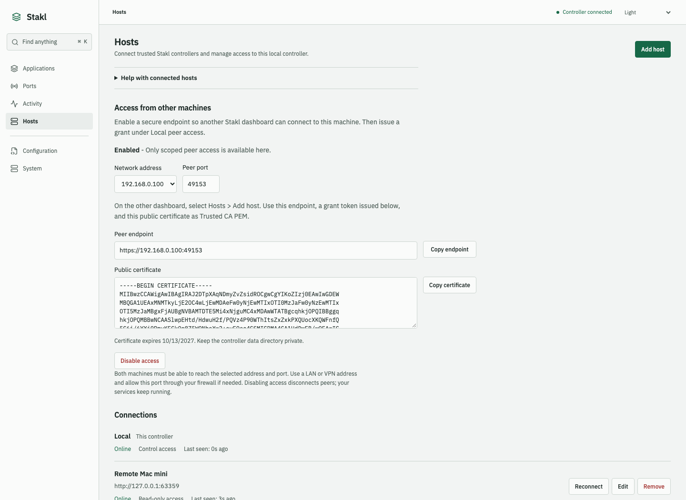
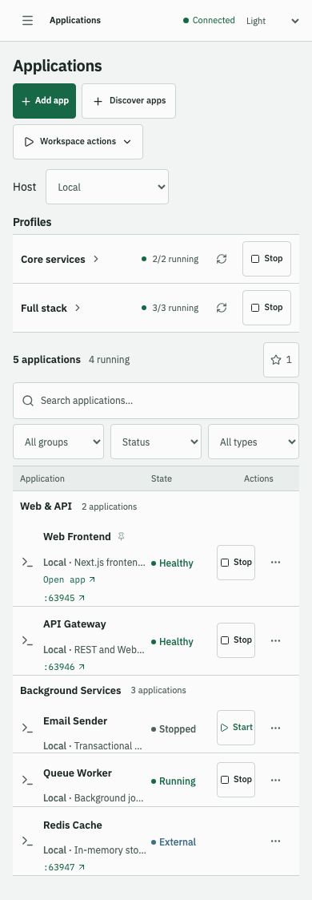

# Stakl

**The local service control plane for developers who run processes across machines.**

[](LICENSE)
[](docs/releases.md)
[](go.mod)
[](https://github.com/bhujelaayushgc/stakl/releases)

Stakl provides a fast workstation dashboard and CLI to manage development servers, scripts, background workers, and Docker Compose projects on macOS and Linux without installing each application as an operating-system service.

Start and stop services, monitor health status, inspect occupied ports, tail live logs, organize projects into profiles, and connect other machines into a single view. Human-editable YAML defines your workspace; SQLite stores runtime history. Stakl ships as a single static executable with an embedded React dashboard: no cloud accounts, external databases, or telemetry required.

<picture>
  <source media="(prefers-color-scheme: dark)" srcset="docs/images/dashboard-dark.png" />
  <source media="(prefers-color-scheme: light)" srcset="docs/images/dashboard.png" />
  
</picture>

*The Stakl Applications view running real workloads in light and dark mode. [View Light](docs/images/dashboard.png) · [View Dark](docs/images/dashboard-dark.png)*

---

## Why Stakl?

### Orchestrate stacks without system daemon sprawl
Running dozens of personal microservices or background workers shouldn't require polluting systemd or launchd. Stakl treats apps as first-class runnable units. Organize them into groups, define start dependency order, and use **Profiles** to bring up entire multi-app stacks (`Core services`, `Full stack`) with a single click or CLI command.

### Process group supervision that survives restarts
Every process launch receives a detached Stakl supervisor, an authenticated private Unix socket, and an isolated workload process group. Supervisors stream output directly to rotating disk logs and survive controller exits. When stopping a service, Stakl signals the entire process group gracefully before escalating to KILL: preventing orphaned child processes and eliminating dangerous PID reuse.

### Gradual adoption: observe without hijacking
You do not need to rewrite your setup on day one. Discover existing repositories on your filesystem, or use **Observe** in Ports to monitor existing TCP listeners and pre-running Docker Compose containers. Observed services stay under the control of their existing process manager while Stakl provides health monitoring, port mapping, and status visibility.

### Connect multiple machines over encrypted peer grants
Run Stakl on your laptop, desktop, and remote build machines. Connect them together through the dashboard over mutual or CA-verified HTTPS. Issue scoped **Read** tokens (inspect status, health, and logs) or **Control** tokens (start, stop, and restart individual apps) without sharing administrative credentials or exposing unprotected endpoints.

---

## Install

Tagged releases provide standalone binaries for macOS and Linux (arm64 and amd64). Install the latest release without needing Go, Node.js, or administrator privileges:

```sh
curl -fsSL https://github.com/bhujelaayushgc/stakl/releases/latest/download/install.sh | sh
```

The installer verifies the archive against its SHA-256 checksum and installs `stakl` to `~/.local/bin`. Ensure that directory is on your `PATH`, then launch:

```sh
stakl
```

The first launch creates `~/.stakl/config.yml`, starts the controller at `http://127.0.0.1:49152`, and opens an authenticated browser session.

### Pinning versions and custom locations

Customize installation by setting environment variables before running the installer:

```sh
# Install a specific release version
curl -fsSL https://github.com/bhujelaayushgc/stakl/releases/latest/download/install.sh | STAKL_VERSION=v0.2.3 sh

# Install to a system-wide path
curl -fsSL https://github.com/bhujelaayushgc/stakl/releases/latest/download/install.sh | STAKL_INSTALL_DIR=/usr/local/bin sh
```

To upgrade, stop the controller cleanly, rerun the installer, and restart Stakl. Configuration and runtime history remain untouched. To uninstall, delete the `stakl` executable; your `~/.stakl` configuration remains intact. See [upgrade and recovery](docs/releases.md#upgrade-and-recovery) for backup and rollback procedures.

### Manual verification and extraction

Download the archive for your platform alongside `checksums.txt` from [GitHub Releases](https://github.com/bhujelaayushgc/stakl/releases), verify the checksum, and extract:

```sh
grep 'stakl-darwin-arm64.tar.gz$' checksums.txt | shasum -a 256 -c -
tar -xzf stakl-darwin-arm64.tar.gz
./stakl-darwin-arm64
```

*(On Linux, replace `shasum -a 256` with `sha256sum`).*

---

## Quick start

The initial workspace starts clean. After running `stakl`:

1. **Add an application:** In **Applications**, click **Add app**. Choose *Process* (executable with arguments), *Shell* (shell pipelines and redirection), *Docker Compose*, or *Custom*. Set your project directory, command, and group.
2. **Review and configure:** Set optional HTTP or TCP health checks, declared ports, environment files, and start dependencies. Saving validates the YAML and creates a backup without immediately starting the service.
3. **Operate and inspect:** Click **Start** on the service row or trigger a profile. Open the details drawer to view live logs, inspect open network ports, or launch an integrated terminal.

For existing repositories, click **Discover apps** and use **Browse** to scan host directories for recognized package and Compose files. See [adding and editing apps](docs/configuration.md#add-and-edit-apps-in-the-dashboard) and [gradual adoption](docs/configuration.md#gradual-adoption-of-existing-services).

---

## Feature tour

<details open>
<summary><b>Live logs & stream filtering</b></summary>

<br />



*Real-time log streaming powered by detached supervisors. Filter by stdout or stderr, search with instant highlighting, toggle line timestamps and wrapping, pause streams, and download retained logs.*

</details>

<details>
<summary><b>Visual application editor</b></summary>

<br />



*Form-based configuration for commands, working directories, process arguments, environment variables, dependencies, and health checks. Switch seamlessly between form controls and raw YAML.*

</details>

<details>
<summary><b>Connected hosts & peer mesh</b></summary>

<br />



*Connect multiple developer machines over HTTPS. Enable access on remote hosts, issue scoped Read or Control tokens, and monitor cross-machine workloads from one dashboard.*

</details>

<details>
<summary><b>Responsive mobile workstation</b></summary>

<br />



*Responsive mobile layout with navigation drawer, touch-friendly profile controls, live status badges, and quick service actions on handheld viewports.*

</details>

---

## Configuration example

Stakl configurations are clean, human-editable YAML stored at `~/.stakl/config.yml`. Here is a representative setup:

```yaml
version: 1
server:
  host: 127.0.0.1
  port: 49152
  open_browser: true

groups:
  web-api:
    name: Web & API
    order: 10
  background:
    name: Background Services
    order: 20

profiles:
  fullstack:
    name: Full stack
    apps: [web, api, worker]
  core:
    name: Core services
    apps: [web, api]

apps:
  web:
    name: Web Frontend
    type: process
    group: web-api
    cwd: ~/projects/web
    start:
      command: npm
      args: [run, dev]
    health:
      type: http
      url: http://127.0.0.1:3000/health
      interval: 2s
    ports:
      - name: HTTP
        port: 3000
    links:
      App: http://127.0.0.1:3000
    depends_on:
      api: { condition: healthy }
    autostart: true

  api:
    name: API Gateway
    type: process
    group: web-api
    cwd: ~/projects/api
    start:
      command: go
      args: [run, ./cmd/server]
    health:
      type: http
      url: http://127.0.0.1:8080/health
      interval: 2s
    ports:
      - name: API
        port: 8080
    links:
      Docs: http://127.0.0.1:8080/docs

  worker:
    name: Queue Worker
    type: process
    group: background
    cwd: ~/projects/worker
    start:
      command: python3
      args: [worker.py, --queue, default]
    stop:
      signal: TERM
      timeout: 10s

  cache:
    name: Redis Cache
    type: external
    group: background
    detect:
      type: tcp
      host: 127.0.0.1
      port: 6379
      interval: 5s
    ports:
      - name: Redis
        port: 6379
```

See [configuration reference](docs/configuration.md), [process management](docs/process-management.md), [Docker](docs/docker.md), and [examples/config.yml](examples/config.yml).

---

## Essential CLI commands

```sh
# Status and inspection
stakl status                         # List all configured applications and states
stakl logs web                       # Print recent logs for an application
stakl logs web --follow              # Tail live stdout and stderr streams

# Lifecycle operations
stakl start web                      # Start an individual application
stakl stop web                       # Stop an application gracefully
stakl restart web                    # Restart an application
stakl start --all                    # Start all configured applications
stakl stop --all                     # Stop all running applications (prompts for confirmation)

# Profile management
stakl profile start fullstack        # Start all applications in a profile
stakl profile stop fullstack         # Stop all applications in a profile
stakl profile restart fullstack      # Restart all applications in a profile

# Configuration and state
stakl config validate                # Check YAML syntax and schema without starting
stakl config path                    # Print active configuration file path
stakl config reload                  # Reload running controller configuration
stakl backup                         # Create a consistent SQLite state snapshot
stakl reset-state --yes              # Reset runtime history while preserving YAML and logs

# Peer access and TLS
stakl tls init --host peer.example   # Generate TLS certificates for remote access
stakl peer tokens create --name Laptop --access read
stakl peer tokens list
stakl peer tokens revoke GRANT_ID
```

Operational commands communicate with the running controller's authenticated API. `config validate`, `config path`, and `tls init` run offline without an active controller. See [HTTPS and headless setup](docs/configuration.md#https-and-headless-peers) for remote controller administration.

---

## Build and run

Building requires Go 1.26.9+ and Node.js 22.x, 24.x, or 26+. The compiled output is a self-contained binary containing all frontend assets: neither Go nor Node.js is required at runtime.

```sh
git clone https://github.com/bhujelaayushgc/stakl.git
cd stakl
make build
./bin/stakl
```

Optionally move `bin/stakl` to a directory on your `PATH`. Override configuration paths or listening ports with command-line flags or environment variables:

```sh
stakl --config /path/to/custom-config.yml
STAKL_CONFIG=/path/to/custom-config.yml stakl
stakl --port 49160 --no-browser
stakl open
```

Configuration resolution order: `--config`, `STAKL_CONFIG`, then `~/.stakl/config.yml`. Each workspace keeps its database, launch credentials, and logs alongside its configuration file.

---

## Architecture and safety

- **Detached supervisors:** Workloads execute under a detached supervisor with private authenticated sockets. The controller never blindly sends signals to cached PIDs: it validates ownership records before issuing shutdown commands.
- **Process group cleanup:** Graceful shutdown signals the entire process group. The supervisor holds the parent process with `waitid(..., WNOWAIT)` until child members exit, preventing PID recycling races.
- **Loopback isolation:** Stakl binds to `127.0.0.1` by default. Browser requests use SameSite, HttpOnly authentication cookies with origin checks and mutation headers. Non-loopback binding requires explicit tokens and TLS encryption.
- **Gradual observation:** External processes (`type: external` or detected TCP listeners) are protected. Stakl monitors availability without acquiring process kill rights.

For deeper architectural details, see [architecture documentation](docs/architecture.md) and [REST/SSE API](docs/api.md).

---

## Development

```sh
make dev            # Backend + Vite HMR development server
make frontend       # Build production frontend assets
make build          # Compile standalone bin/stakl
make test           # Run Go race tests and frontend Vitest suite
make lint           # Go vet/format checks and TypeScript verification
make integration    # End-to-end integration test with disposable processes
make browser-test   # Chromium browser regression and screenshot test suite
make dist           # Cross-compile CGO-free binaries for macOS and Linux
```

Review [CONTRIBUTING.md](CONTRIBUTING.md) before submitting pull requests and [SECURITY.md](SECURITY.md) for vulnerability reporting.

---

## Documentation

- [Configuration Reference](docs/configuration.md): Form controls, YAML syntax, detection, dependencies, and options.
- [Process Management](docs/process-management.md): Supervision lifecycle, signals, group isolation, and restarts.
- [Docker Compose](docs/docker.md): Container observation, compose lifecycle, and log streaming.
- [Architecture & Security](docs/architecture.md): Supervisor sockets, credential boundaries, and recovery.
- [API Reference](docs/api.md): REST endpoints, Server-Sent Events, and client authentication.
- [Examples](docs/examples.md): Practical configuration templates for web, microservices, and databases.
- [Release Process](docs/releases.md): Versioning, artifact verification, and release checklists.
- [Contributing](CONTRIBUTING.md): Environment setup, browser test execution, and screenshot capture.
- [Security Policy](SECURITY.md): Vulnerability disclosure and security contacts.

---

## License

Stakl is open-source software licensed under the [MIT License](LICENSE).
